<div align="center">

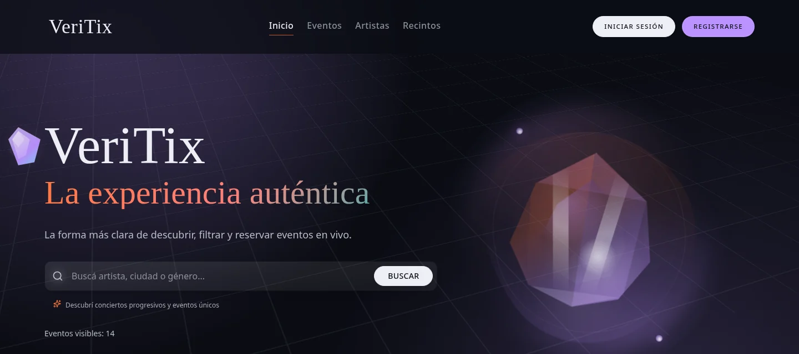

# VeriTix

<p>
  <strong>Full-stack concert ticketing platform</strong><br/>
  Discovery, checkout, ticket delivery, QR validation, and backoffice operations in one monorepo.
</p>

<p>
  
  
  
  
  
</p>

<p>
  
  
  
  
</p>

<p>
  <a href="#whats-implemented">What's implemented</a> •
  <a href="#screenshots">Screenshots</a> •
  <a href="#quick-start">Quick start</a> •
  <a href="#architecture">Architecture</a> •
  <a href="#implementation-highlights">Highlights</a> •
  <a href="#authors">Authors</a>
</p>

</div>

---

VeriTix is a concert ticketing platform built as a monorepo with a Nuxt 4 frontend and a NestJS backend. It covers the full flow from event discovery and checkout to ticket issuance, QR validation, and backoffice operations.

It is structured like a real product, not a demo: server-side API proxying, role-based access, a Stripe order flow driven by webhooks, Prisma persistence, Redis-backed caching and queues, and automated tests across both apps.

## What's implemented

| Area | What it covers |
| --- | --- |
| **Public catalog** | Events, artists, and venues, filterable by name, artist, venue, genre, and city |
| **Accounts** | Registration with email verification, JWT access tokens, rotating refresh tokens in HTTP-only cookies |
| **Commerce** | Ticket types with stock reservation, Stripe Checkout, webhook-driven order completion, cancellation, and refunds |
| **Tickets** | Ticket generation with encrypted QR payloads, per-user ticket wallet, ticket transfers between users |
| **Door validation** | A validator role that checks a ticket from its QR payload and marks it as used |
| **Backoffice** | Dashboard with revenue and sales KPIs, event / artist / venue / genre / format / user management, sales reports, and live access control with venue occupancy |
| **Community** | Favorites and reviews with star ratings |
| **Operations** | Image uploads (Cloudinary), transactional email (Resend), scheduled event reminders (BullMQ), rate limiting, Swagger docs |

Four roles drive the experience: `BUYER`, `CREATOR`, `VALIDATOR`, and `ADMIN`. The REST API exposes roughly 70 endpoints across 14 domain modules.

## Screenshots

All screenshots come from the app running locally with the seed data included in the repo.

### Discovery

<table>
  <tr>
    <td width="50%"></td>
    <td width="50%">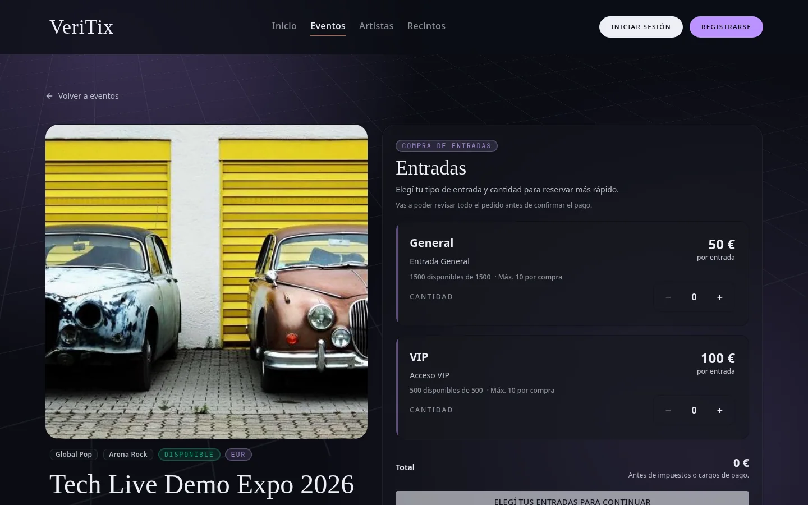</td>
  </tr>
  <tr>
    <td align="center"><sub>Featured events on the home page</sub></td>
    <td align="center"><sub>Event detail with ticket types, stock, and price summary</sub></td>
  </tr>
  <tr>
    <td width="50%">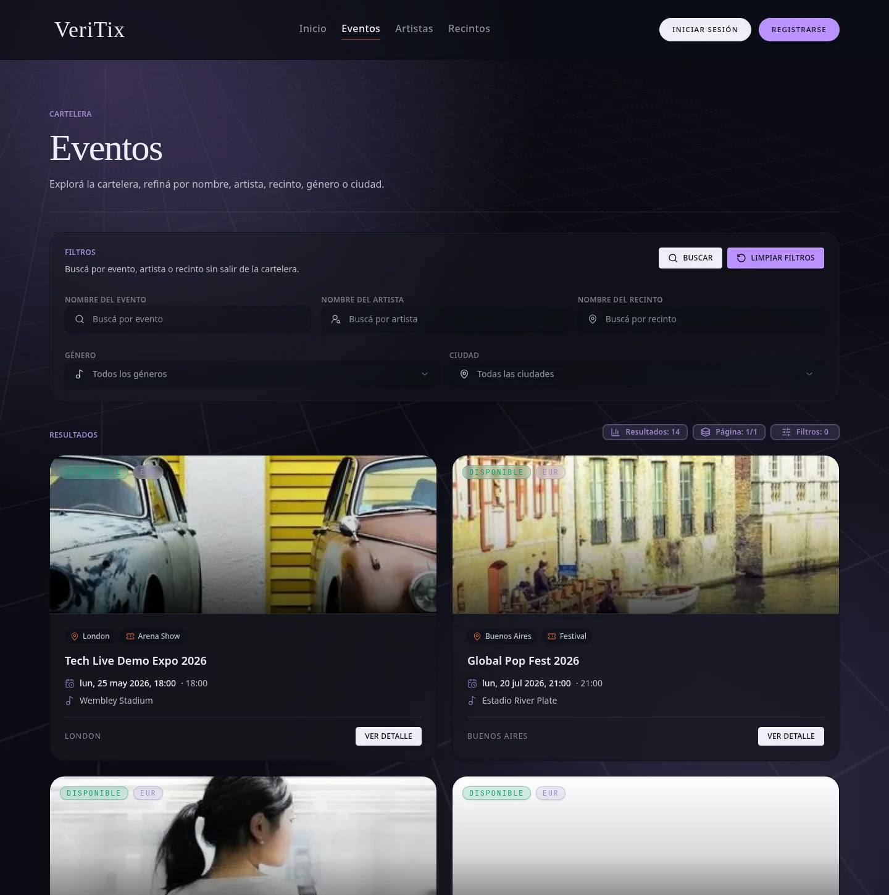</td>
    <td width="50%">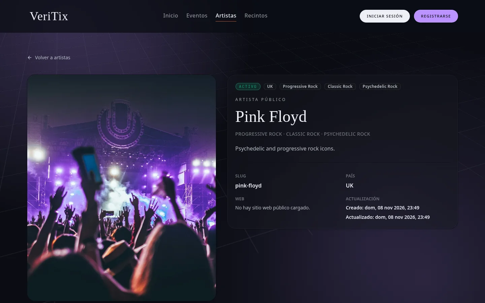</td>
  </tr>
  <tr>
    <td align="center"><sub>Catalog with filters by event, artist, venue, genre, and city</sub></td>
    <td align="center"><sub>Artist profile</sub></td>
  </tr>
</table>

### Buyer account

<table>
  <tr>
    <td width="50%">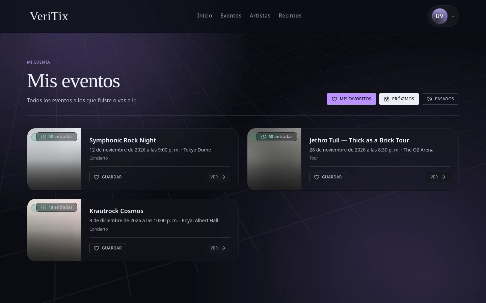</td>
    <td width="50%">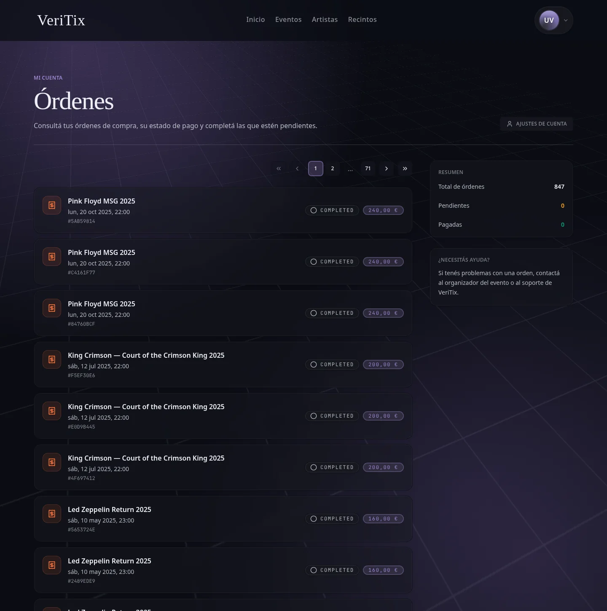</td>
  </tr>
  <tr>
    <td align="center"><sub>My events and tickets</sub></td>
    <td align="center"><sub>Order history with status</sub></td>
  </tr>
</table>

### Backoffice

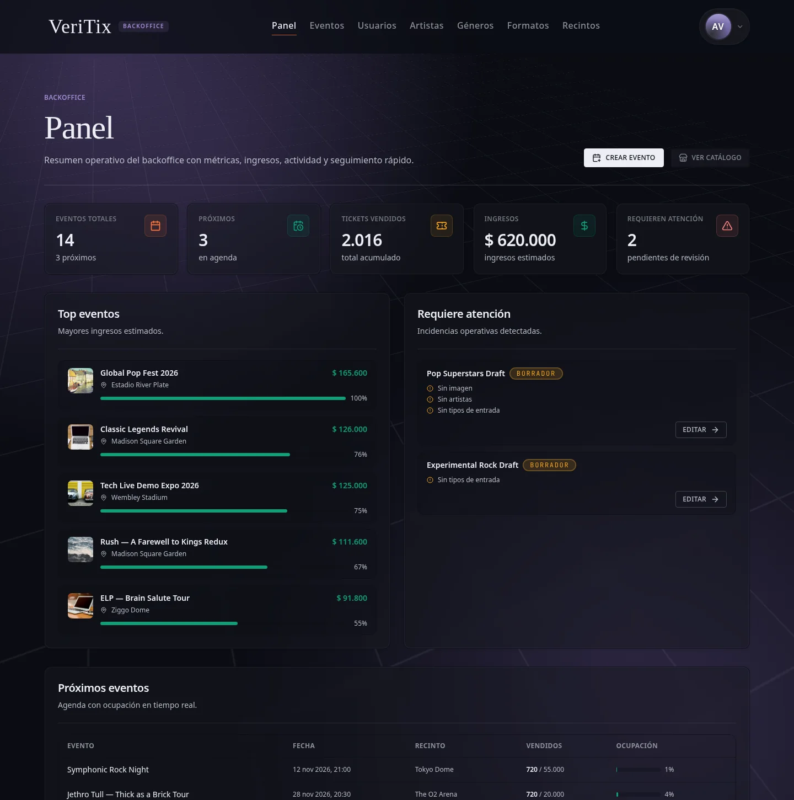

<sub>Dashboard with revenue and ticket KPIs, top events by revenue, and events that need attention.</sub>

<table>
  <tr>
    <td width="50%">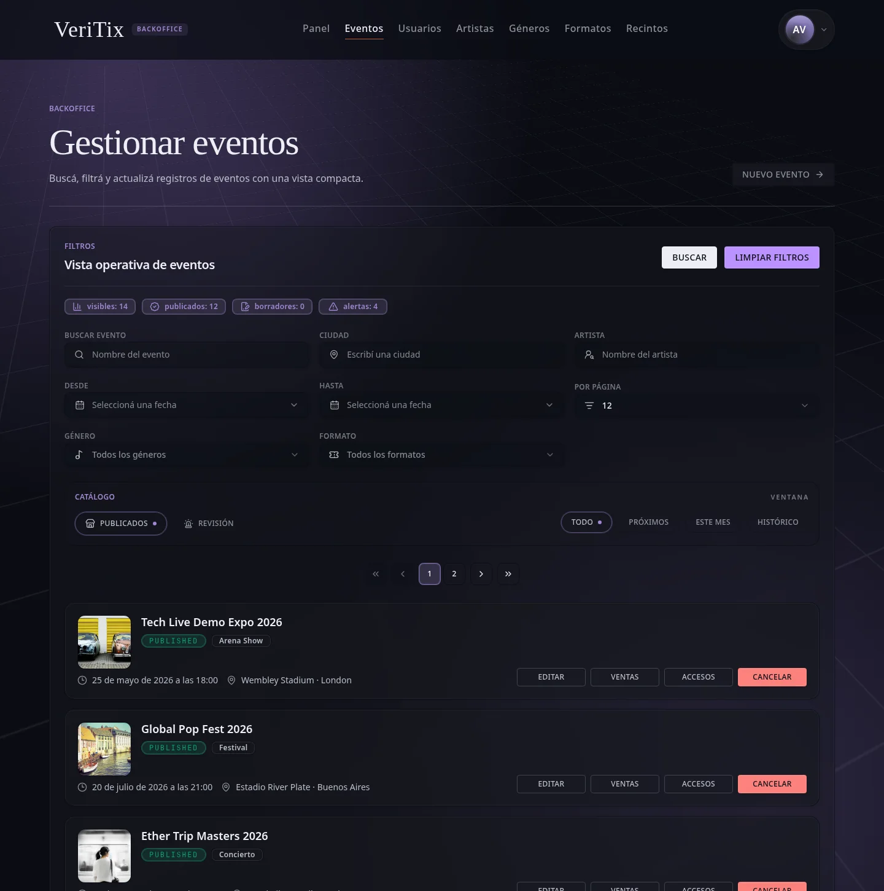</td>
    <td width="50%">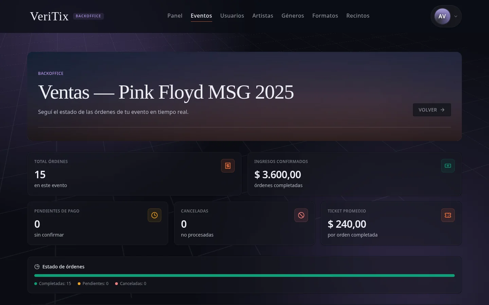</td>
  </tr>
  <tr>
    <td align="center"><sub>Event management with filters and per-event actions</sub></td>
    <td align="center"><sub>Sales report per event</sub></td>
  </tr>
</table>

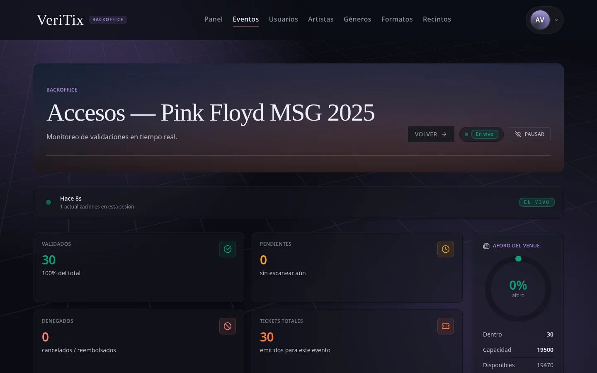

<sub>Live access control with validated tickets and venue occupancy.</sub>

### Door validation

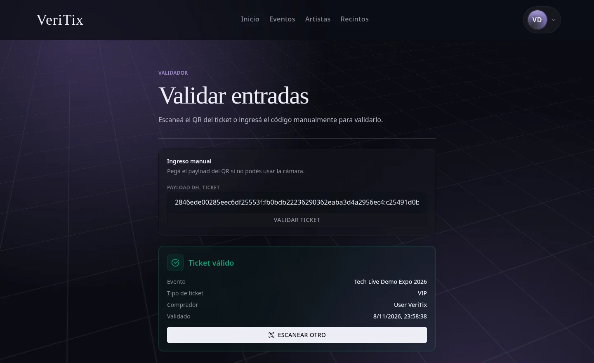

<sub>A validator checks a ticket from its QR payload and gets the event, ticket type, buyer, and validation time.</sub>

## Quick start

### Full stack with Docker Compose

The repository includes a root `docker-compose.yml` that starts PostgreSQL, Redis, the NestJS API, and the Nuxt frontend.

1. Create the required environment files from the examples included in the repo.
2. Start the stack:

```bash
docker compose up --build
```

3. Open:

- Frontend: `http://localhost:3000`
- Backend API: `http://localhost:3001/api/v1`
- Swagger docs: `http://localhost:3001/docs`

Checkout needs a Stripe test key, and sign-up (email verification) and transactional email need a Resend key. Browsing, the seeded demo accounts, the backoffice, and door validation work without them.

### Run apps manually

```bash
# backend
cd backend
bun install
bun run migrate:deploy
bun run db:seed
bun run start:dev

# frontend
cd frontend
bun install
bun run dev
```

Other scripts:

- Frontend: `bun run build`, `bun run preview`, `bun run test`, `bun run typecheck`
- Backend: `bun run test`, `bun run test:e2e`

### Demo accounts

`bun run db:seed` loads artists, venues, published events, finished events with orders, and these accounts (local development only):

| Role | Email | Password |
| --- | --- | --- |
| Admin | `admin@veritix.app` | `Admin1234!` |
| Buyer | `user@veritix.app` | `User1234!` |
| Creator | `creator@veritix.app` | `User1234!` |
| Validator | `validator@veritix.app` | `User1234!` |

The passwords come from `ADMIN_PASSWORD` and `USER_PASSWORD` when set.

## Architecture

```text
Browser
  -> Nuxt 4 frontend (SSR + Nitro server routes)
  -> server-side proxy/cache layer
  -> NestJS REST API (/api/v1)
  -> Prisma
  -> PostgreSQL / Redis / external providers
```

### Monorepo structure

- `frontend/`: Nuxt 4 SSR app, UI, route middleware, server routes, and public API caching
- `backend/`: NestJS API organized by domain modules
- `docs/`: architecture, requirements, status notes, and supporting documentation

### How the pieces fit

The browser does not talk to the backend directly in the main authenticated flows. Nitro server routes proxy requests to NestJS, forward cookies and authorization headers, normalize backend errors, and rewrite auth cookie paths at the frontend boundary.

The backend owns business rules, persistence, security, and integrations. It exposes a versioned REST API, validates payloads globally, serves Swagger at `/docs`, and is organized into focused modules such as auth, events, orders, tickets, reviews, favorites, uploads, and ticket transfers.

## Implementation highlights

- **Auth boundary:** access tokens travel as bearer tokens, while refresh tokens live in HTTP-only cookies and are rotated server-side.
- **Proxy-aware cookies:** the frontend proxy rewrites backend auth cookie paths so the browser works cleanly through the Nuxt layer.
- **Payment fulfillment:** order completion depends on Stripe webhook events, not only on the client checkout redirect.
- **Webhook-safe parsing:** the Nest app preserves raw request bodies so Stripe signatures can be verified.
- **Layered caching:** Redis-backed caching in the backend, plus cache headers and in-memory caching in Nitro for public catalog endpoints.
- **Encrypted ticket payloads:** QR payloads are encrypted, and validation resolves them back to the ticket hash on the server.
- **Background jobs:** event reminders run as BullMQ jobs, separate from the request cycle.
- **Role-driven surface:** the schema and routes support `BUYER`, `CREATOR`, `VALIDATOR`, and `ADMIN`.

## Tech stack

| Area | Technology |
| --- | --- |
| Frontend | Nuxt 4, Vue 3, Nitro, Tailwind CSS 4, Zod |
| Backend | NestJS 11, Prisma 7, Joi, Swagger, BullMQ |
| Data | PostgreSQL 18, Redis 8 |
| Payments and messaging | Stripe, Resend, Cloudinary |
| Tooling | Bun, Vitest, Jest, Supertest, k6, Docker Compose |

## Testing

The repository has 103 test files: 55 in the backend and 48 in the frontend.

- Frontend: Vitest unit tests plus Nuxt-oriented tests for auth, repositories, and public pages
- Backend: Jest unit, integration, and e2e suites, plus k6 smoke, load, stress, and soak scripts

## Repository notes

- Root orchestration lives in `docker-compose.yml`.
- Swagger is enabled in `backend/src/main.ts`.
- Domain and boundary notes are in `docs/markdown/ARCHITECHTURE.md`.

## Authors

VeriTix was built by two developers:

- Juan Rangel ([@Piioni](https://github.com/Piioni))
- [@ErickJoelQuispe](https://github.com/ErickJoelQuispe), the owner of the [original repository](https://github.com/ErickJoelQuispe/VeriTix) this one is forked from
